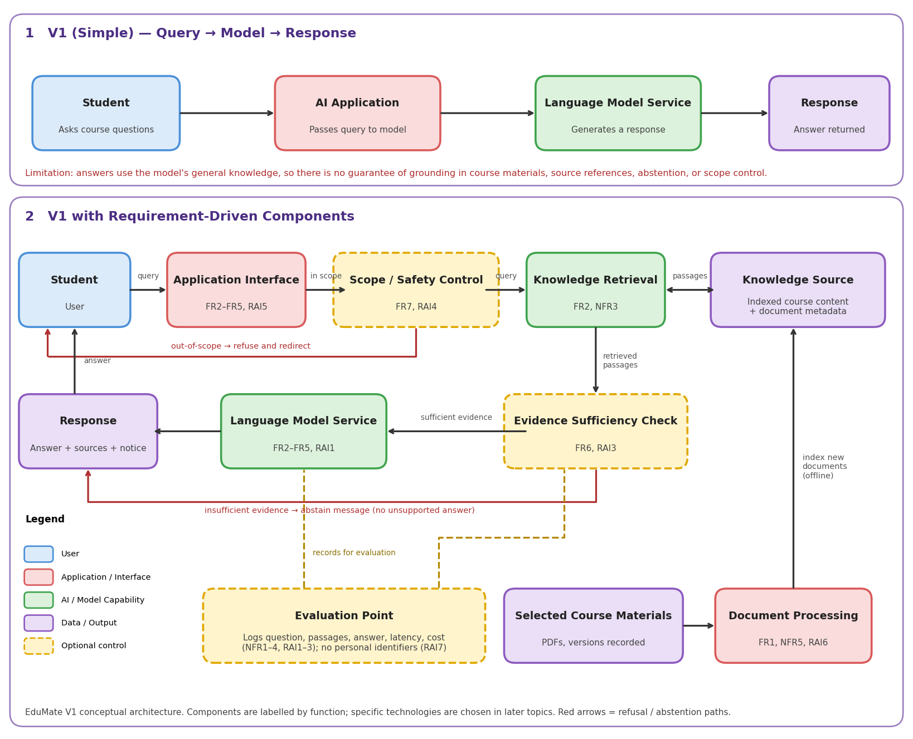

# EduMate — AI-Powered Course Material Learning Assistant

> EduMate helps university students understand course materials by answering questions and explaining concepts using AI, with every answer grounded in the selected documents and supported by source references.

## Problem Statement

University students often struggle to understand complex concepts and find specific information in lengthy lecture notes and textbooks. EduMate uses AI to retrieve relevant information from course documents and generate simple, understandable explanations supported by source references.

## Evidence of the Problem

- Open educational resources such as [OpenStax](https://openstax.org/higher-education) give students free textbooks, but students must still search through long materials to find and understand specific concepts.
- Research on retrieval-augmented generation (RAG) in education identifies hallucination, outdated knowledge, and limits in information retrieval as challenges for AI-based learning support ([Systematic Survey](https://doi.org/10.1016/J.CAEAI.2025.100417)).

## Initial Related Work / Existing Approaches

- **Traditional educational chatbots:** Can answer predefined questions but may struggle with flexible questions ([ScienceDirect](https://www.sciencedirect.com/science/article/pii/S2949719124000499)).
- **RAG-based educational systems:** Retrieve relevant information to support AI-generated answers but may still produce unsupported information.
- **Open educational resources:** Provide accessible textbooks, but students may still need help locating and understanding specific concepts.

## Engineering Gap / Limitation

Existing learning resources do not always provide interactive explanations, while general-purpose AI assistants may generate answers that are not supported by the student's course materials. EduMate aims to provide document-grounded answers, simplified explanations, and source references. This is a practical engineering gap, not a claim of scientific novelty.

## Project Objectives

- **O1:** Design an AI learning assistant that answers questions using selected course materials.
- **O2:** Develop a RAG-based system with semantic search and document retrieval.
- **O3:** Evaluate answer correctness, source relevance, groundedness, and response time.

## Target Users

Undergraduate university students, initially focusing on selected computing and engineering subjects.

## Application Scope

**Supported tasks:** process PDF course materials, answer natural-language questions, explain concepts in simple language, summarise a specified section or topic, show source references, and say when the materials do not contain enough evidence.

**Out of scope:** academic advising or course registration, answering from knowledge outside the indexed materials, completing graded assignments or exams, medical/legal/financial/mental health advice, and replacing lecturers or original textbooks.

## Main Features

- PDF course material processing
- Question answering using natural language
- Simplified explanations of difficult concepts
- Study material summaries
- Source references for generated answers
- Abstention when evidence is insufficient
- Refusal and redirect for out-of-scope requests

## Data Sources

- [OpenStax College Physics 2e](https://openstax.org/details/books/college-physics-2e)
- [OpenStax textbook collection](https://openstax.org/subjects)
- [OpenStax Higher Education](https://openstax.org/higher-education)
- Additional publicly accessible textbooks relevant to the selected subject will be documented before implementation. Exact titles, editions, and access permissions will be confirmed before use.

## Requirements Summary

Full details are in [`docs/week2_requirements.md`](docs/week2_requirements.md).

| Type | IDs | Focus |
|---|---|---|
| Functional | FR1–FR7 | PDF ingestion, question answering, source references, simplified explanations, summaries, abstention, scope refusal |
| Non-functional | NFR1–NFR6 | Latency, correctness, retrieval relevance, cost, maintainability, usability |
| Responsible AI | RAI1–RAI7 | Groundedness, citations, abstention, scope and academic integrity, over-reliance, source provenance, privacy |

## Evaluation Plan

The system will be evaluated using a curated set of questions with reference answers. Full criteria are in [`docs/week2_evaluation_criteria.md`](docs/week2_evaluation_criteria.md).

| Criterion | Metric | Threshold |
|---|---|---|
| Answer correctness | Correct response rate | ≥ 80% |
| Retrieval relevance | Hit rate @ top 5 passages | ≥ 85% |
| Groundedness | Answers with all claims supported | ≥ 90% |
| Source citation and support | Citation presence; citation–source match | 100%; ≥ 95% |
| Abstention | Correct abstention; false abstention | ≥ 90%; ≤ 15% |
| Out-of-scope refusal | Refusal-and-redirect success rate | ≥ 95% |
| Explanation clarity | Mean clarity score (1–5) | ≥ 4.0 |
| Response latency | p90 latency | < 8,000 ms |
| Inference cost | Cost per 100 queries | < US$1.00 (illustrative) |

**Test sets:** ≥ 50 answerable questions with reference answers, ≥ 20 unanswerable questions, and ≥ 20 out-of-scope queries.

## V1 Architecture

The V1 architecture starts from the simplest flow (Student → Application → Language Model Service → Response) and adds components only where requirements need them: document processing and a knowledge source for grounding, retrieval, an evidence sufficiency check for abstention, a scope/safety control, and an evaluation point. Architecture decisions, trade-offs, and the requirements traceability matrix are in [`docs/week2_architecture_decisions.md`](docs/week2_architecture_decisions.md).

## Technology Stack (Provisional)

Specific technologies will be selected and refined in later topics. Current candidates:

- Python
- Streamlit
- Sentence Transformers
- FAISS or ChromaDB
- Large Language Model (LLM)
- Retrieval-Augmented Generation (RAG)

## Responsible AI

- Display source references to support verification.
- Abstain instead of generating unsupported answers when evidence is insufficient.
- Refuse out-of-scope requests, including requests to complete graded work.
- Use reputable learning materials and record document titles, versions, and URLs.
- Tell students that answers are AI-generated and should be verified against the original materials.
- Avoid storing personal identifiers from student queries.

## Documentation

| File | Description |
|---|---|
| [`docs/week1_project_scope.md`](docs/week1_project_scope.md) | Week 1 project scope |
| [`docs/week2_requirements.md`](docs/week2_requirements.md) | Project framing, application scope, functional, non-functional, and Responsible AI requirements |
| [`docs/week2_evaluation_criteria.md`](docs/week2_evaluation_criteria.md) | Evaluation criteria, datasets, and clarity rubric |
| [`docs/week2_architecture_decisions.md`](docs/week2_architecture_decisions.md) | Architecture needs, ADRs, traceability matrix, and reflection |
| [`docs/week2_architecture_v1.png`](docs/week2_architecture_v1.png) | V1 conceptual architecture diagram |

## Weekly Progress

| Week | Focus | Deliverable | Status |
|---|---|---|---|
| W1 | Project scoping and GitHub setup | README and project scope | Complete |
| W2 | Requirements, evaluation planning, and V1 architecture | Requirements, evaluation criteria, V1 architecture, ADR, and traceability matrix | Complete |
| W3 onwards | System development and testing | Prototype and evaluation results | Planned |
