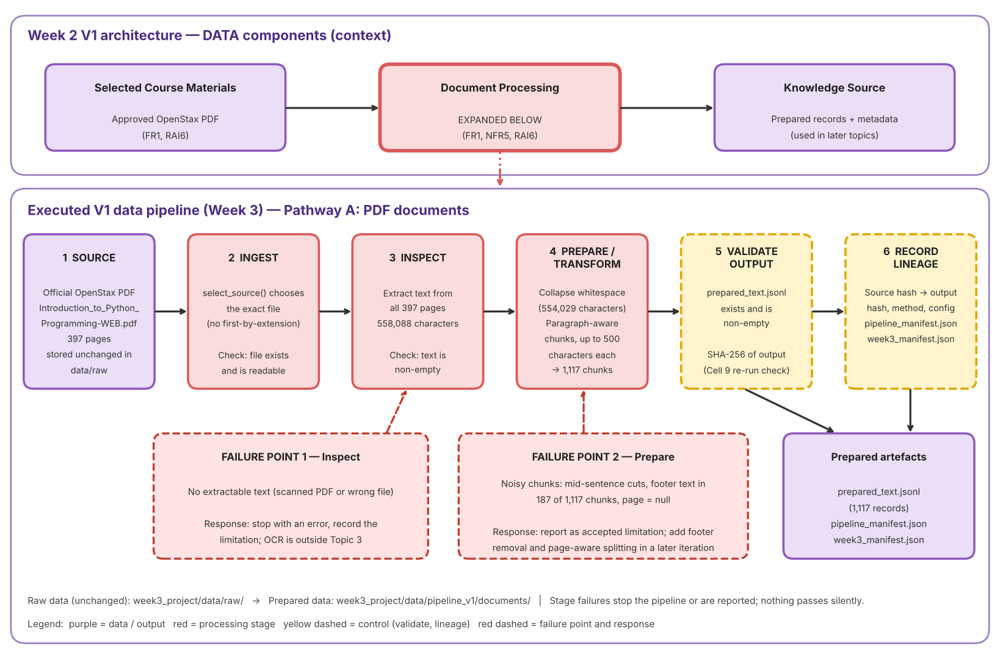

# Pipeline Decisions — EduMate (Week 3)

Version: 1.0

## 1. Requirements and Source

| Item | Record |
|---|---|
| **Topic 2 requirements** | FR1 (process selected PDF course materials), FR2 and NFR3 (answers and retrieval depend on chunk quality), FR3 and RAI2 (source references), RAI6 and NFR5 (provenance and maintainability) |
| **Architecture component** | Selected Course Materials → Document Processing → Knowledge Source (V1 architecture, `week2_architecture_v1.png`) |
| **Selected source (S01)** | `Introduction_to_Python_Programming-WEB.pdf`, official OpenStax PDF, 397 pages, stored in `week3_project/data/raw/` |
| **Pathway** | A: PDF / text |
| **Not used** | College Physics 2e (D2): OpenStax requires written permission to ingest the book into LLM or generative AI offerings, so it is not processed. |

## 2. Part B Comparison and Evidence

Both approaches used the same input: 397 pages, 558,088 extracted characters, 554,029 characters after whitespace cleaning.

| | Approach A: fixed-size chunks | Approach B: paragraph-aware chunks |
|---|---|---|
| **Configuration** | 500 characters per chunk | Up to 500 characters, split at blank lines where possible |
| **Chunks produced** | 1,109 | 1,117 |
| **Observed evidence** | Cuts at exactly 500 characters. | Only 8 more chunks than fixed (0.7%), so few blank-line paragraph breaks exist in the extracted text. Most chunks still end at an arbitrary point. Sample chunks 301 and 302 split mid-sentence ("...if a business'" / "'s two condition operands..."). A truth table (chunk 302) came through readable. |
| **Common to both** | Footer text "Access for free at openstax.org" appears in 187 of 1,117 chunks (16.7%). Quiz questions appear without their answers (chunk 303). No page numbers are kept (`page` is `null`). | |

**Selected approach:** paragraph-aware, 500 characters (`paragraph-aware-char-500`).

- **Benefit:** It keeps short paragraphs and section breaks together when the text provides them, and it matches the Part B configuration, so Part B and Part C results are consistent.
- **Accepted limitation:** In this PDF it behaves almost like fixed-size chunking, so chunks can start or end mid-sentence, repeated footers remain, and no page numbers are stored. This will lower retrieval relevance (NFR3) and limit page-level citations (FR3, RAI2).

## 3. Preparation Configuration

| Setting | Value |
|---|---|
| Text extraction | `pypdf`, all pages |
| Cleaning | Collapse runs of spaces and tabs; trim ends. No footer or header removal. |
| Chunking | Paragraph-aware, maximum 500 characters |
| Record fields | `id`, `source`, `text`, `page` (null) |
| Pipeline version | `week3-v1` |

## 4. Differences Between Part B and Part C

| | Part B (Cell 5A2) | Part C (Cell 8A) |
|---|---|---|
| Record ID | Text ID such as `Introduction_to_Python_Programming-WEB-0001` | Number (`1`, `2`, ...) |
| Source field | Path relative to `data/raw` | Full local path |
| Checksum in each record | Yes (`source_sha256`) | No; stored once in `pipeline_manifest.json` |
| Processing label | In each record | In the manifest only |
| Output location | `data/processed/` | `data/pipeline_v1/documents/` |

The chunk text and the number of chunks (1,117) are the same, because the configuration is unchanged. Part C records the full local path, so manifests contain a machine-specific folder name (see Section 8).

## 5. Stage Contracts

| Stage | Contract / evidence | Failure response |
|---|---|---|
| Ingest | `select_source()` finds the exact PDF in `data/raw`; the file is permitted (OpenStax, CC BY-NC-SA 4.0). | Stop with `FileNotFoundError` for missing input. |
| Inspect | The PDF opens and yields non-empty text (397 pages, 558,088 characters). | Stop with an error if no extractable text (scanned PDF; OCR is outside Topic 3). |
| Prepare | Chosen method produces chunks of up to 500 characters (1,117 chunks). | Stop if no chunks are produced or the method name is invalid. |
| Validate | `prepared_text.jsonl` exists, is non-empty, and has a SHA-256 fingerprint. | Stop for missing or empty output. |
| Record lineage | Source hash, output hash, method, and configuration are saved in `pipeline_manifest.json`; Part B in `week3_manifest.json`. | Stop or report a missing mapping or metadata. |
| Repeatability (Cell 9) | A second run gives the same source fingerprint, output fingerprint, and mapping. | Assertion fails if any fingerprint changes. Result: **[paste Cell 9 PASS line]** |

## 6. ETL or ELT

**Decision: ETL.** The PDF is extracted, cleaned, and chunked before the prepared records are stored. This suits the project because the raw PDF is not queryable as it is, cleaning and chunking are needed before any search can use the text, and the data is one small document, so there is no data warehouse to load raw data into and transform later. The raw PDF stays unchanged in `data/raw/`, and the prepared records are stored separately.

## 7. Batch or Streaming

**Decision: batch.** The textbook is a fixed document that changes only when OpenStax issues a new edition, so there is no continuous flow of data. The pipeline runs on demand when a document is added or updated (NFR5). The time taken to prepare a new document will be recorded against the NFR5 threshold (under 15 minutes) when the system is evaluated.

## 8. Output Location and Provenance / Access Caveats

| Item | Location |
|---|---|
| Part B prepared output | `week3_project/data/processed/prepared_text.jsonl` |
| Part B lineage manifest | `week3_project/data/week3_manifest.json` |
| Part C prepared output | `week3_project/data/pipeline_v1/documents/prepared_text.jsonl` |
| Part C run manifest | `week3_project/data/pipeline_v1/documents/pipeline_manifest.json` |

**Caveats**
- **Manifest defaults:** The manifests record `source_version` and `access_rights` as "Not verified" by default. The verified values are in `week3_data_inventory.md`: OpenStax *Introduction to Python Programming*, ISBN 978-1-961584-45-7, original year 2024, ©2026, CC BY-NC-SA 4.0.
- **AI-use restriction:** The restriction OpenStax states for College Physics 2e has not been checked for this book. Check the book's web-view citation panel before using the prepared text with any language model service.
- **Prepared text is book content:** `prepared_text.jsonl` contains the textbook's text, so treat it as licensed material. Do not commit it, or the raw PDF, to a public repository unless the licence and your lecturer allow it. Keep `week3_project/data/raw/` and `data/processed/` in `.gitignore` and share the manifests and documentation instead.
- **Local paths:** `pipeline_manifest.json` stores full local paths, which can include your username. Check and edit them before committing.
- **Hash scope:** A matching checksum shows the file is unchanged. It does not show permission to share or data quality.

## 9. Known Limitations Carried to Later Topics

| Limitation | Effect | Planned response |
|---|---|---|
| Footers in about 17% of chunks | Noise in retrieved passages | Strip footers before chunking |
| Mid-sentence chunk boundaries | Weaker retrieval relevance (NFR3) | Use a sentence- or heading-aware splitter |
| No page numbers | Page-level citations not possible (FR3, RAI2) | Keep page-level records and a page-aware splitter |
| Quiz questions without answers | Bare questions retrieved as content (FR7, RAI1) | Tag or exclude exercise blocks |
| Tables, formulas, and code only partly preserved | Possible errors in answers (NFR2) | Test with table, formula, and code questions in Topic 4 |
